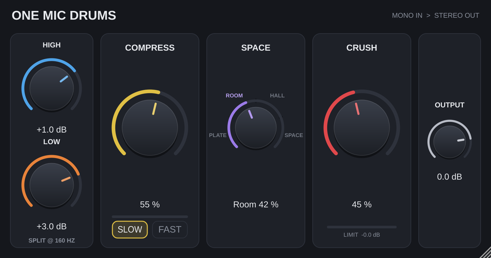

# One Mic Drums

Plugin für Pro Tools, Logic, Cubase, Ableton & Co., um **Drums, die mit nur einem Mikrofon aufgenommen wurden**, fett zu mischen. Ein Mono-Signal geht rein, ein Stereo-Signal kommt raus.



## Bedienung

| Regler | Was er macht |
|---|---|
| **High** / **Low** | Das Signal wird bei **160 Hz** in zwei Bänder geteilt (Linkwitz-Riley, 24 dB/Okt.; beide auf 0 dB = unverändert). Low = Bassdrum-Druck, High = Snare, Becken, Raum. −24 dB = Band aus. |
| **Compress** | Ein Regler für alles: je weiter auf, desto tiefer der Threshold (bis −32 dB) und desto höher die Ratio (1:1 bis 12:1). Die Aufholverstärkung passiert automatisch. Der gelbe Balken zeigt die Gain-Reduction. |
| **Slow / Fast** | Attack. **Slow** (25 ms) lässt den Anschlag durch → mehr Punch. **Fast** (0,8 ms) fängt die Transiente → dichter, glatter. |
| **Space** | Hall als **Parallel-Bus** (trockenes Signal bleibt voll erhalten). 0 = trocken, 1. Viertel **Plate**, 2. **Room**, 3. **Hall**, 4. **Space** (sehr groß). Dazwischen geht der Charakter fließend über. Der Hall wird nur ab ca. 200 Hz gespeist, damit die Bassdrum nicht verschwimmt. |
| **Crush** | Drive (bis +20 dB) in eine Sättigung (4× Oversampling) und einen Limiter mit 1 ms Lookahead. Je weiter auf, desto lauter und dichter („crushed“). Die Spitze bleibt immer bei −0,5 dBFS. |
| **Output** | Ausgangspegel. |

Doppelklick auf einen Regler = Standardwert.

**Mono → Stereo:** Die Bässe bleiben exakt in der Mitte. Die Höhen bekommen ein dezentes, dekorreliertes Seitensignal (M/S). Das löscht sich in Mono vollständig aus: Die Mono-Summe ist also wieder das Originalsignal, ohne Kammfilter. Dazu kommt der Hall in echtem Stereo.

**Hinweis:** Der Limiter am Ende arbeitet auch bei Crush 0 als Schutz gegen Übersteuerung (Decke −0,5 dBFS). Das Plugin meldet dem Host eine kleine Latenz (≈ 1 ms + Oversampling), die DAWs automatisch ausgleichen.

### In der DAW einsetzen
- **Logic:** Auf der Mono-Spur den Plug-in-Slot öffnen und **Mono → Stereo** wählen. Danach Audio Units → Tech Assistent → One Mic Drums.
- **Pro Tools:** Auf der Mono-Spur ein **Multichannel**-Plug-in mit **Mono/Stereo** wählen (nur mit AAX-Build, siehe unten).
- **Cubase / Ableton / Reaper:** Auf die Mono-Spur legen. Der Ausgang ist stereo.

## Bauen

Benötigt: CMake ≥ 3.22 und einen C++17-Compiler (Xcode auf dem Mac, Visual Studio 2022 unter Windows). JUCE 8 wird automatisch heruntergeladen.

```bash
cd plugin/OneMicDrums
cmake -S . -B build -DCMAKE_BUILD_TYPE=Release
cmake --build build --config Release
```

Ergebnis unter `build/OneMicDrums_artefacts/Release/`:
- macOS: `AU/One Mic Drums.component` → `~/Library/Audio/Plug-Ins/Components/`, `VST3/One Mic Drums.vst3` → `~/Library/Audio/Plug-Ins/VST3/`, dazu eine Standalone-App
- Windows: `VST3/One Mic Drums.vst3` → `C:\Program Files\Common Files\VST3\`

**Ohne eigenen Compiler:** Jeder Push auf `plugin/**` startet auf GitHub den Workflow „Plugin bauen“ (Mac + Windows). Die fertigen Plugins liegen unter *Actions → Lauf → Artifacts*. Diese Builds sind **nicht signiert**. Auf dem Mac deshalb nach dem Kopieren einmal ausführen:
`xattr -cr ~/Library/Audio/Plug-Ins/Components/"One Mic Drums.component"` (beim VST3 genauso).

### Pro Tools (AAX)
AAX braucht das **AAX SDK** von Avid (kostenlos nach Registrierung unter developer.avid.com):

```bash
cmake -S . -B build -DAAX_SDK_PATH=/pfad/zum/aax-sdk
```

Damit Pro Tools das Plugin im normalen Betrieb lädt, muss es mit **PACE/iLok (wraptool)** signiert werden. Den Signier-Account vergibt Avid/PACE auf Anfrage. Ohne Signatur läuft es nur in der Entwickler-Version „Pro Tools Developer“.

### Lizenz von JUCE
JUCE 8 ist frei nutzbar unter AGPLv3 (dann muss der Plugin-Quellcode offen sein) oder mit einer JUCE-Lizenz (für Einzelpersonen/kleine Firmen bis 50.000 $ Umsatz kostenlos, „JUCE Starter“). Vor einem Verkauf klären.

## Testen

```bash
cmake -S . -B build -DOMD_BUILD_TESTS=ON
cmake --build build --config Release
./build/OneMicDrumsTest_artefacts/Release/OneMicDrumsTest out   # erwartet „OMD OK“
```

Das Messprogramm schickt einen synthetischen Mono-Drumloop durch das Plugin. Es prüft:
- Mono-Summe = Eingangspegel
- Bässe exakt mittig
- Bänder getrennt regelbar
- mehr Compress = mehr Reduktion, Fast fängt Spitzen
- Hall-Ausklang je Bereich
- Crush lauter, aber nie über 0 dBFS
- keine NaN-Werte bei zufälligen Einstellungen

Außerdem schreibt es Hörbeispiele (`out/*.wav`) und ein Bild der Oberfläche (`out/gui.png`).

## Aufbau des Codes

- `Source/PluginProcessor.*` – Signalweg: Weiche → Kompressor (`OneKnobCompressor`) → Mono→Stereo (`MonoToStereo`) → Hall (`SpaceReverb`) → Crush/Limiter → Output
- `Source/PluginEditor.*` – Oberfläche (frei skalierbar, Seitenverhältnis fest)
- `Tests/OfflineTest.cpp` – Messprogramm
